[Home](../Home.md) / [Adventures](../Adventures.md) / Return to the Lighthouse <!-- wikidown:breadcrumb -->

# Return to the Lighthouse

**[Flipbook](Return-to-the-Lighthouse/Flipbook.md)**: just the images, in play order. **[Vision Handouts](Return-to-the-Lighthouse/Vision-Handouts.md)**: the printable player cards.

*The party's return to the Lighthouse — the tower in full, the visions at the door, Erleena coming up to meet them, the airlock, the lab fifty feet under the lake, and the scientist who decides the cure is on Aerun and that she is going to get it.*

## The tower in full

*The party comes off the bridge with the froghemoth behind them, into the inner garden on the island. It is the first time anyone has stood this close to the tower with nothing trying to eat them. Let the moment be quiet.*

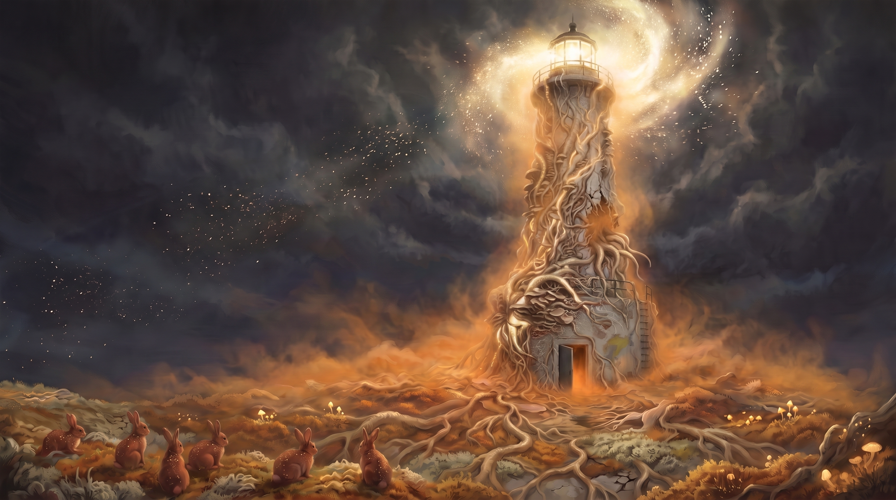

**On the table:** play the [looping clip](../.attachments/lighthouse_island.mp4) full-screen on repeat and say nothing for a few seconds. It's 8 seconds, wide, and seen from the island floor. The beam turns one full circle like a real lighthouse: out over the distance, a gold flare as it swings past the viewer, and dim behind the tower. A drone plays underneath. There's also a [tall version](../.attachments/lighthouse_awe.mp4) without the beam.

> *The rabbits are the first thing. A dozen of them in the moss under the tower, fat and soft and the colour of rust, flecked gold where the spores have taken. They lift their heads when you come off the bridge. All of them at once. Then they go back to grazing, all of them at once.*
>
> *Then you look up.*
>
> *The halo is not a halo up close. It is a galaxy, slow and enormous, turning around the lantern room: arms of gold light, and in the arms, points of light that are each a single spore catching the lamp. The cords on the tower are pulsing, not glowing. Light runs up them from the ground and down them from the lamp, slow as breathing, and the moss under your boots pulses with it. It is the most beautiful thing any of you has ever seen, and it is very hard to look away.*

**No roll yet.** Let them stare. The trip starts at the door ([below](#the-door)).

## On the island (DM notes)

**Don't let the beam touch you.** The halo goes to whatever the beam lights; a flyer caught in it is dragged down to the island and lands in the thick of it (exposure save, [Russet Mold & Infection](../Game-Mechanics/Russet-Mold-and-Infection.md)). Walk it like a searchlight — move when it's away, hold when it's near.

**The comms (DM note).** Nothing radio gets in or out of the hull — the ship's hyper-dimensional fields filter RF the same way they blind the Aura network and stop teleportation ([Ship-wide properties](../The-Lost-Ship.md)). Every call the party made from Frostwatch died in that void: *"No signal. Your number cannot be completed."* Not spores, not the tower's output, not Eddie. Inside the hull the wiring reaches everywhere — Eddie has watched the whole crossing, and Erleena's lab below the garden sits on the same internal comm line as George's pocket at S42, which is why she and George have talked every day for a month and still can't reach each other: the garden is between them, not the wiring. So Erleena knows everything George knows — the half-cure, the rabbitoid, the packs, that the party reached S42 — and nothing at all from the outside world. **That gap is the party's cue.** They are carrying a month of news she has never heard, and the council's news above all.

**The last time they spoke.** The party's last words with Erleena were in these sealed levels on the first survey: she told them she would build her cure lab here, and she asked them to make sure the big cargo door could never open again. Then they left through that same door, on the purge and never got a call through again. She has not forgotten either thing.

## The door

*The party crosses the island to the base of the tower and the open door, the doorway glowing orange and spores spilling out of it at ground level. This is where the trip begins.*

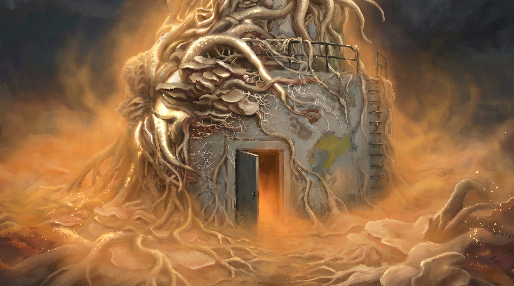

**On the table:** there are two clips, one for each vision. Both open and close on the same door, and both loop.

- **The [connected clip](../.attachments/lh_door_connected.mp4)** runs 45 seconds. The gold threads carry the view through the rabbits, the valley of animals moving as one, the harbour town where blue implants braid into the gold, and up to the whole world, then back down the roots to the door. The drone is warm and major-key.
- **The [desert clip](../.attachments/lh_door.mp4)** runs 34 seconds. The tower splits open on a scorching, sand-blasted desert of black glass spires, the view pushes through the rift, pulls back, and the rift closes. The drone builds into a harsh wind.

Start the connected clip as the party reaches the door. Switch to the desert clip when you turn to anyone who rolled a 1.

> *Up close the door is just a door. Steel, old, standing open a hand's width. The light coming out of it is warm. The air coming out of it is warm. It smells like rain on hot stone, which is wrong, because there hasn't been rain or hot stone anywhere near here for a very long time.*

**The roll.** Everyone at the door rolls a **d6**:

| d6 | What happens |
| :-: | :--- |
| **1** | **The desert** vision. |
| **2–3** | **The connected world** vision. |
| **4** | **Headache.** 1d6 psychic damage, and disadvantage on Intelligence and Wisdom checks until a short rest. |
| **5** | **Faint.** Prone and unconscious for 1 minute, or until shaken awake (an action) or damaged. |
| **6** | **Clear head.** Nothing happens. |

Any number of players can land on any result. With five at the door, someone sees the desert more often than not. If nobody does, play the connected clip only.

**Handouts.** There's a short printable card for each result on [Vision Handouts](Return-to-the-Lighthouse/Vision-Handouts.md). Hand them out after the rolls.

**This is the tower reaching for them.** The visions and the backlash are both psionic attacks from the Lighthouse, not the spores. They deal no infection, and nobody makes an infection save for them. A shake, a slap or a spore-blast in the face brings anyone out of a vision early.

### The connected world (d6: 2–3)

For about a minute they stand at the threshold, smiling. Eddie's voice reaches them from very far away. It's a mushroom trip, not a nightmare. Give them two or three of these, told in the second person, and let them describe what they do:

- **Everything is breathing.** The ground, the tower and the water all rise and fall together, and so do you. You can't remember which of you started it.
- **The threads.** Fine gold threads run out of the soil and into everything: the rabbits, the moss, the bridge, the frog in the water, the people standing next to you. You realize, as if you've always known, that they run into *you*.
- **You can hear the rabbits.** Not the sound they make. Their heartbeats, a dozen of them in step, and yours keeping time with them.
- **The pattern.** The tower's cords, your hand, the veins in a leaf and the spiral of the galaxy are all the same shape. It is funny that nobody ever noticed. Someone may laugh out loud.
- **No edges.** For a moment you aren't sure where your skin stops and the air starts, and you don't mind. You are not alone. You have never been alone.
- **Time goes soft.** The beam takes a year to sweep past. Then the moment is over and you have been standing there for a minute.
- **The wild.** You are on a mountainside at dawn, and the whole valley is moving: deer, foxes, wolves, a bear, goats on the crags, ravens overhead, all walking together like one animal, none afraid of the others. Under the snow, the gold threads run like veins of light.
- **The glowing ears.** A town in the snow at dusk, lanterns lit, everyone laughing. The blue lights behind their ears are pulsing, and from each one a thread of blue rises and twines with the gold, person to person, to the dogs and the goats and the gulls. Nobody in the town is alone. Nobody has ever been alone.
- **The whole world.** You are very high up. Below you is the world, every land you know and some you don't, and all of it is laced with gold, branching like roots, with blue lights at the knots. It looks like a brain. It looks like it's breathing.

**Show them.** After the read-aloud, show the picture that goes with each piece of their vision:

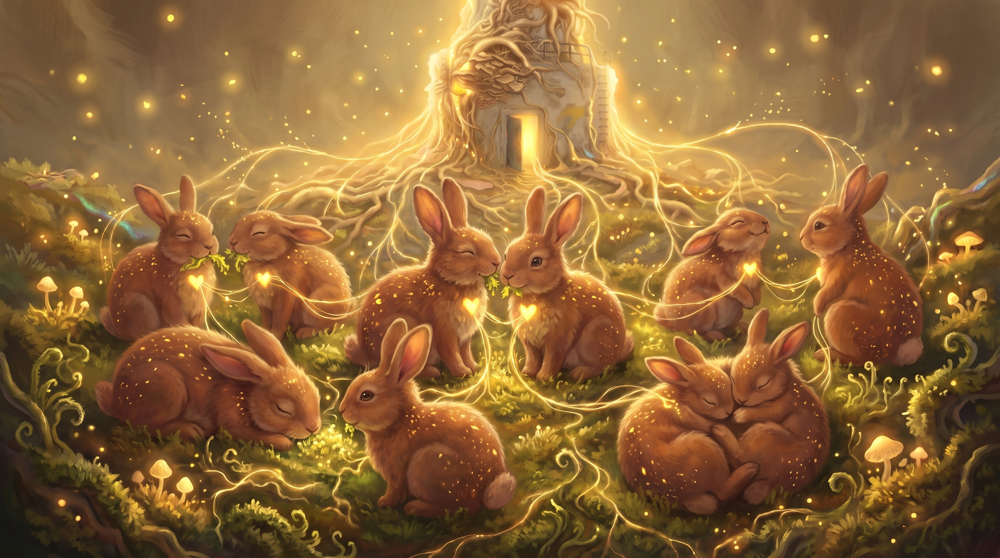

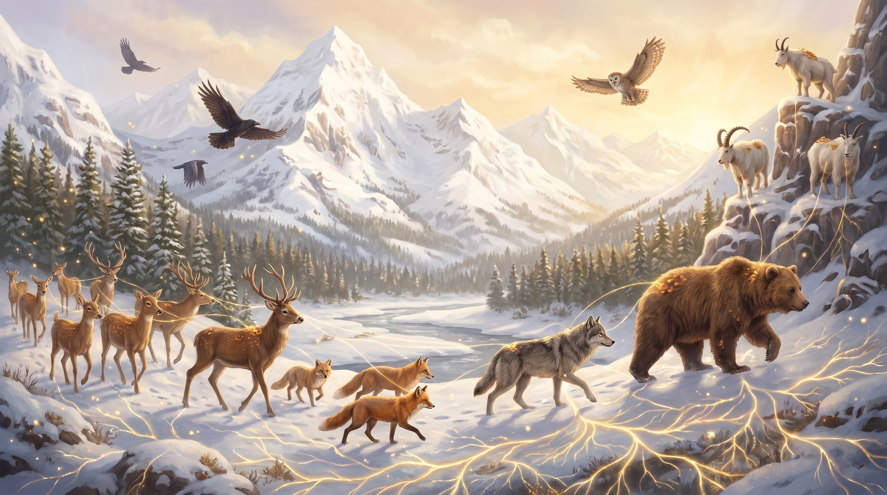

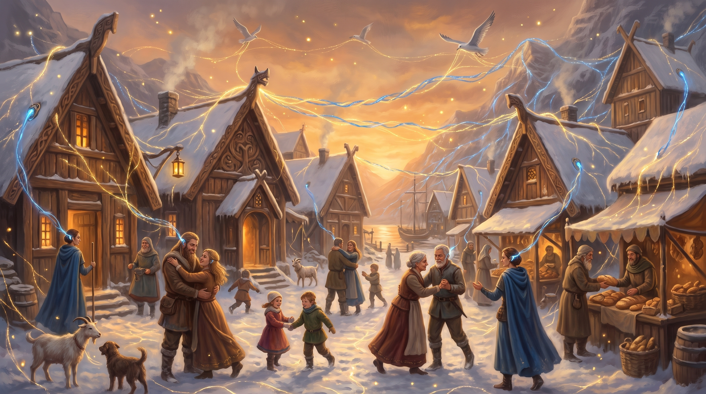

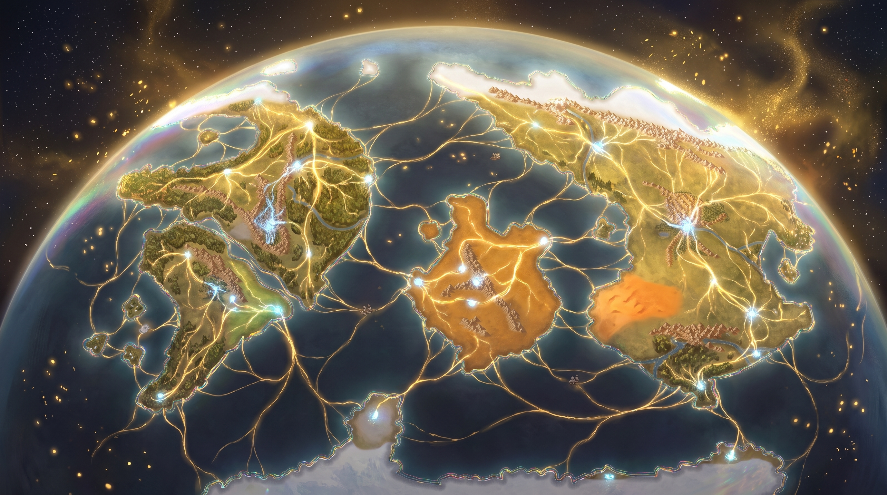

**What it leaves behind: hope.** They come out of it sure of something, the way you're sure of a dream. The spores aren't the enemy. Let them spread and they'll join the whole world into one web: every person, every animal, all feeling what the others feel. With that much empathy, nobody would ever hurt anyone again. It would be a utopia. *Why would anyone want to stop that?* It's a feeling, not a compulsion. Let the player decide how hard it holds their character.

*DM only: the glowing-ears and whole-world visions put the Aura network into the same web as the spores. That is the party's withheld theory ([The Invisible Infection](../Campaign/Plot-Threads/The-Invisible-Infection.md)), and it feels wonderful from inside. The vision does not confirm the theory. Leave that thread open.*

### The desert (d6: 1)

Read it to them alone, in the second person, and show them this when you're done:

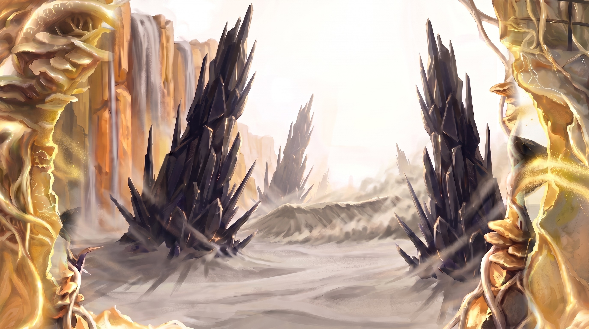

> *The wall in front of you splits. Not breaks. Opens, the way a curtain opens, along a seam of white light that runs up from the door and out of sight. Behind it there is no tower. There is a desert: a grey sea of dust, flat to the end of the world, under a white sky that presses down like a hand. The wind comes through the split hot and full of grit, and it stings. Black glass grows out of the dust in huge splintered spires, all shards and spikes, taller than the tower, and gold spores stream off their broken tips, through the split and over you. The light comes from there, and so do the spores. It has always come from there. Out between the spires the sand heaves up in one long curving ridge and keeps moving, as if something underneath it is swimming. Then the seam closes and the door is just a door.*

**What it leaves behind: urgency.** They come out of it with a strong pull toward the deserts of Aerun, as if part of them is already there, and with a hard certainty: *that's* where the spores are stopped, and it's the only way. They have to get there, and soon. It's a feeling, not a compulsion. Let the player decide how hard it drives their character.

**The two visions disagree.** If both turn up, one player now feels the spores should be left alone to make a better world. The other feels they must be stopped, and only in the desert. Let them argue about it on the way down the stair.

*DM only: the grey sea is the Sea of Silt on Aerun, the obsidian spires stand on it, and the ridge is wormsign. It is the other Salient's ground ([The First Source](../Campaign/Plot-Threads/The-First-Source.md), [The Silt Sea](../World/Dark-Sun/The-Silt-Sea.md)). This is foreshadowing for the long arc that ties the two together ([The Ship's Purpose](../Campaign/Plot-Threads/The-Ships-Purpose.md)). Don't name any of it at the table, and don't confirm it when the players guess. When Erleena names Aerun later on this page, let anyone who saw the desert make the connection on their own.*

### The backlash (d6: 4–5)

They never see anything. The tower pushes into their minds, finds nothing it can use, and pushes harder:

- **Headache (4).** A spike behind the eyes, like a cold drink taken too fast, and it stays. They take **1d6 psychic damage** and have **disadvantage on Intelligence and Wisdom checks** until they finish a short rest.
- **Fainting (5).** The world tilts and they go down. They fall **prone and unconscious for 1 minute**, or until someone spends an action to shake them awake or they take damage. They wake with a nosebleed and no memory of falling.

### The clear head (d6: 6)

Nothing happens to them. They see the others go still, hear one of them laugh, and watch another drop to the moss. Eddie's voice in their ear is perfectly clear: *"Is everyone all right? Some of your readings are doing something very interesting."*

**Afterward.** Nothing in the visions has a face, a voice or a name. Each conviction arrives as a feeling. Erleena will want to hear about all of it, flatly and in detail, and she'll write it down. **Telling it sideways:** nothing here says what the tower is. The rabbits moving in unison and the threads running into *everyone* are the network seen from the inside, and that is all the players get.

## Erleena comes up

*The party may not want to walk through that door, and after the visions, that's fair. They don't have to. Eddie has been calling the whole crossing to her like a regatta, and she has heard enough.*

> *The orange light in the doorway goes dark for a moment, because someone is standing in it. A pressure suit, battered orange and tan, with a clear bubble helmet. Inside the helmet, a tired face you know, and it is grinning. Erleena raises a gloved hand and waves, then looks at whoever is still on the moss, and at the rabbits. Her voice comes out of a little speaker on her chest.*
>
> *"You came back. You're late, but you came back. I heard about the frog." She holds out a gloved hand. "Sprayer. George made one with my name on it. Give it here."*

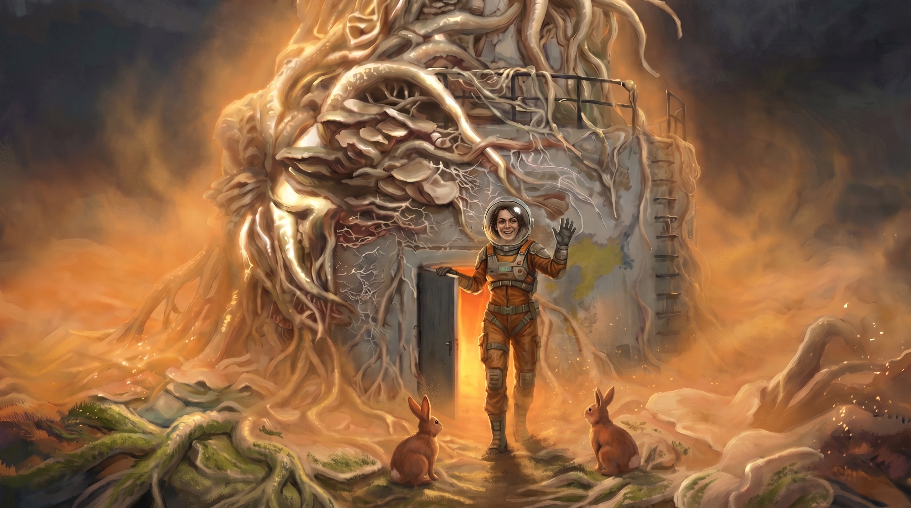

**The sixth pack.** If the party brought the spare spore-blaster George made for her, she takes it, shoulders it over the suit and cinches the straps without being shown. If they didn't, she takes someone's: *"He made one for each of you and one for me. At no point did anyone do the subtraction."* If anyone is still out cold from the door, she nudges them awake with her boot first.

**She clears the tower.** She walks straight in and starts spraying. The mold peels off the stone in sheets, and the mushrooms wilt where the cone touches them. She works methodically, wall, stair, floor, the way somebody cleans a lab, and says nothing until the path to the hatch is clear. Let the party follow her in or watch from the door.

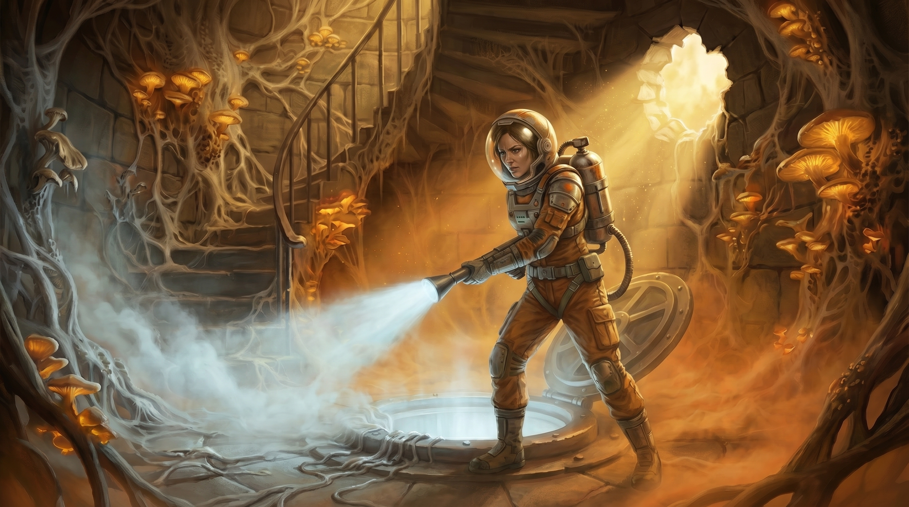

**The hatch.** It's the same heavy floor hatch where the party first found her a month ago. She came up through it, so this time it opens easily on her word: no Strength check, no key card. *"Mind the ladder. It's wet. Everything's wet. That's the point."* She goes down first.

## The airlock

At the bottom of the ladder is a small round airlock: riveted steel, amber lamps, a grated floor with drains. The hatch above swings shut, and the inner door to her lab stays shut until everyone has been washed.

> *She unlatches the bubble helmet and pulls it off, and for once she's almost smiling. Then she unhooks a hose from the wall. "Arms up. All of you. Nothing comes into my lab with spores on it, and that includes the bird."*

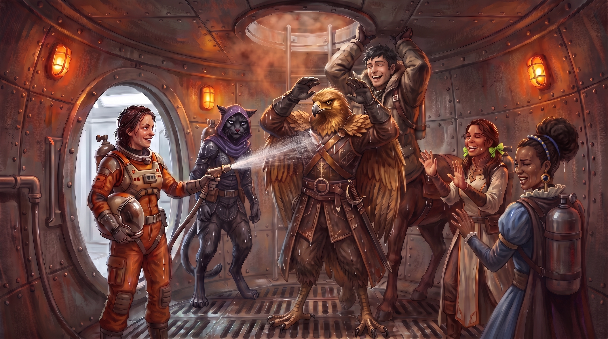

Play it for comedy. Everyone gets soaked. The tabaxi hates it, the centaur barely fits, and Eustace will want to complain. She doesn't stop until she's satisfied. Then the inner door rolls open on white light.

## Erleena's lab

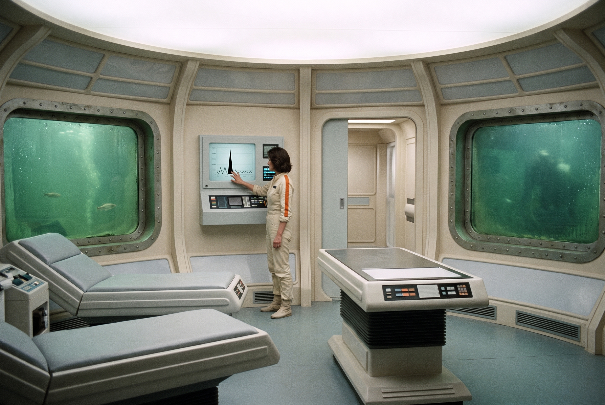

> *The room behind the door is bright and white and humming: biobeds, wall screens, green lake water behind round windows. She steps out of the suit, and underneath is a cream uniform with an orange stripe down the sleeve. She hangs the suit by the door and looks at each of you.*
>
> *"Well. You came back. Don't make a thing of it." Then, before anyone can sit down: "Eddie says some of you saw things at the door. Tell me. All of it."*

### What she knows

Eddie and George have kept her up to date, so she already knows about Frostwatch, the council, the spread, the second source on Aerun, and the frog. She doesn't need the news. She wants the visions.

- **The mold is a symptom.** A month of readings shows the same black spike, every day a little taller, pointing up at the tower. Something is pushing into the world through the Lighthouse, and the spores are what it looks like.
- **Her cure works in a dish.** She has stopped the strain growing. To finish it she needs a second sample to compare against, and time.
- **The tower has noticed her.** Small infected things from the lake throw themselves at her windows day and night.
- **Aerun is her subject.** She wrote the book: *[A Brief History of Vermoon](../Aerun-Players-Guide/A-Brief-History-of-Vermoon.md)*, the hottest history book on Aerun. She did her internship at a dig in the northern desert.
- **Getting out is easy now.** With the spore-blasters, the party can close the big door ([The Jammed Override](The-Awakened-Ship/The-Jammed-Override.md)) and walk out of the ship. George and Eddie stay to hold it.

### The desert vision

If anyone saw the desert, this is the moment the scene turns on. She goes very still and starts asking questions:

> *"Were there obsidian spires? Black glass, standing up out of grey dust? Was the sky white?"*

When they say yes, she knows exactly where that is: the Sea of Silt on Aerun, where her old dig was. If the light and the spores were coming *from* there, then the answer is there too. **She decides to leave with the party, now, and go to Aerun.**

If nobody saw the desert, she gets there anyway from the connected-world vision ("everything is joined to something, so where is the other end?") and from what Harah said at the council about a second source on Aerun. It just takes longer.

### What she says

Pick a few when the talk needs a push:

- *"Were there obsidian spires? Can you describe them?"*
- *"I did my internship in the northern desert. Two seasons of sand in my teeth. I know that sky."*
- *"The mold isn't the disease. It's the symptom. I've spent a month treating the fever."*
- *"Everything joined together sounds lovely until you ask who's holding the other end."*
- *"I wrote a book about Aerun, as part of my doctoral thesis. I have it here somewhere, in my library of holding."*
- *"George stays. Someone has to keep that thing busy, and he's better at it than either of us."*
- *"The Lighthouse is a protrusion into our reality from another, darker one. Where it touches the garden, we get the spores."*
- *"The spores are the effect of the black salient. But we can't close it here."*
- *"George and Eddie can contain the spread, if we get that door to stay closed."*
- *"Eddie. Print me a box of* A Brief History of Aerun*. A full box. We're taking them with us."*

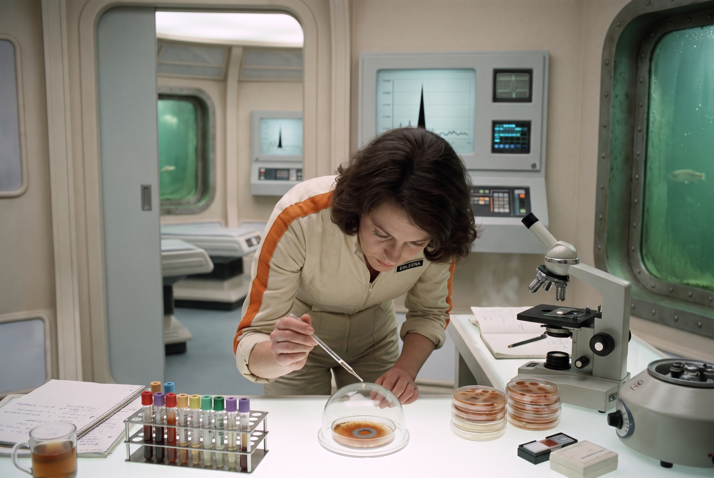

### Leaving

- **She packs in two minutes**: notes, slides, the dish under glass, the sixth dose, her sprayer. Then a **box of her books, about 50 lb**, which someone else carries. Not negotiable.
- **Back to S42** for George, and then out through the breach to Korrin's sleds: **[The Send-Off](Return-to-the-Ship/The-Send-Off.md)**.

---

*Deeper knowledge:* [Erleena Riser](../NPCs/Erleena-Riser.md) · [George Decay](../NPCs/George-Decay.md) · [Shhhmeowmeow](../Campaign/The-Party/Shhhmeowmeow.md) · [The Jammed Override](The-Awakened-Ship/The-Jammed-Override.md) · [The Lighthouse](../The-Lost-Ship/The-Lighthouse.md) · [The Garden Level](../The-Lost-Ship/The-Garden-Level.md) · [Froghemoth](../Bestiary/Ship-Creatures.md) · [The Counteragent](../Game-Mechanics/The-Counteragent.md) · [The Elemental Cities](../World/The-Elemental-Cities.md) · [Aerun](../World/Aerun.md) · [The Lighthouse Dilemma](../Campaign/Plot-Threads/The-Lighthouse-Dilemma.md) · module: [Return to the Ship](Return-to-the-Ship.md)
