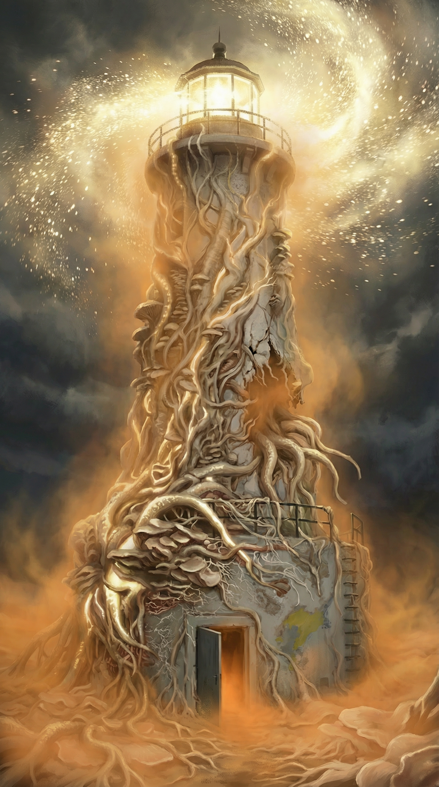
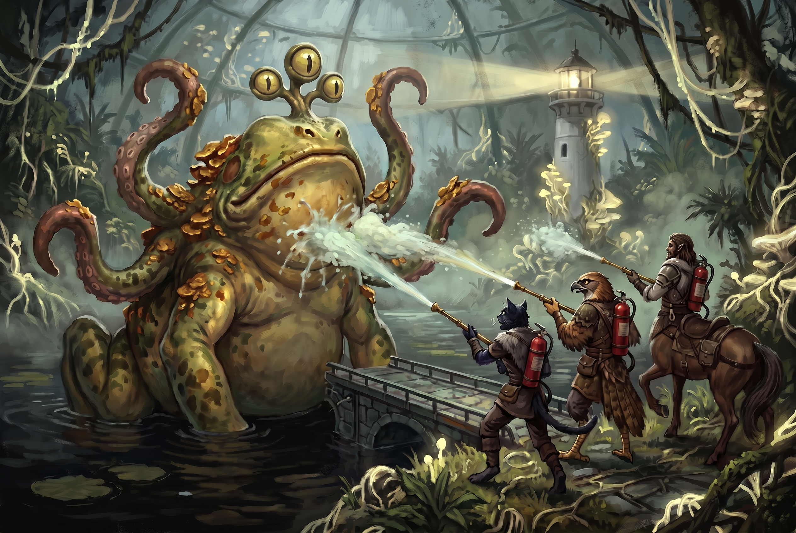

[Home](../../Home.md) / [Adventures](../../Adventures.md) / [Return to the Lighthouse](../Return-to-the-Lighthouse.md) / Flipbook <!-- wikidown:breadcrumb -->

# Return to the Lighthouse: Flipbook

