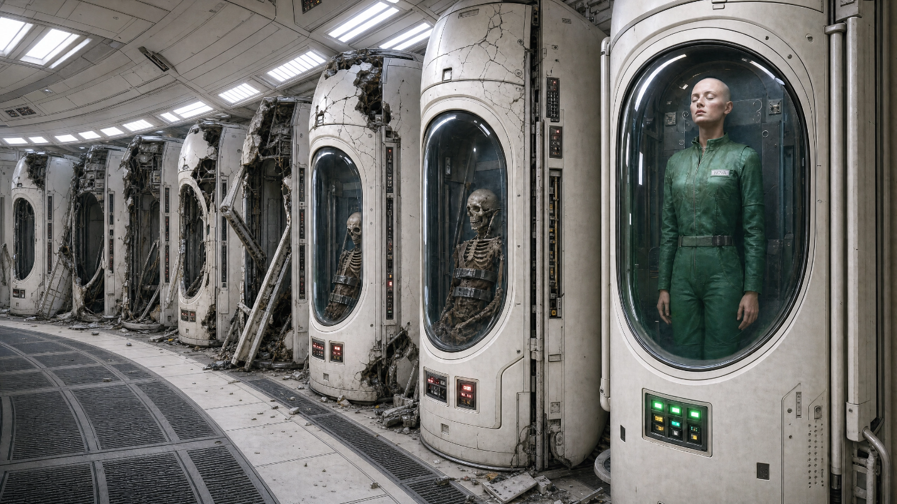
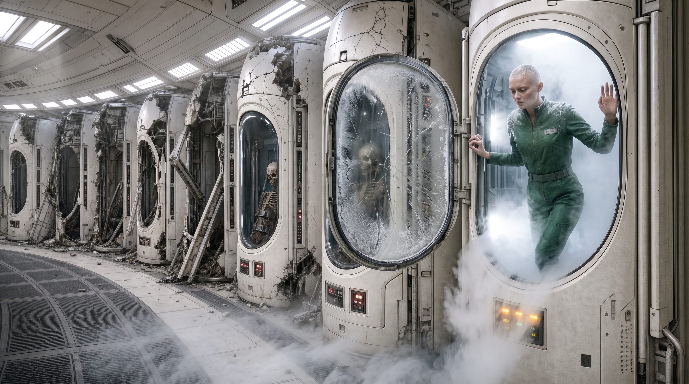

[Home](../../Home.md) / [Adventures](../../Adventures.md) / [Return to the Ship](../Return-to-the-Ship.md) / Nova <!-- wikidown:breadcrumb -->

# Nova

*Return to the Ship, the hidden extra: a living woman in a stasis pod on the lower deck, a few doors from the cargo booth. Nobody has told the party she exists, because nobody knows, not even Eddie. Run it only if they go looking.*

## When it happens

On the way out ([The Send-Off](The-Send-Off.md), *Getting out*). The stair under Erleena's lab comes down on the lower deck, and the party walks past S64b, the stasis chamber, on the way to the cargo booth. Don't point at it. Eddie lights the corridor ahead of them and says, of that one dark door, *"I don't go down that way much. It's just machinery."* His map says so. It's wrong.

If nobody opens the door, she stays asleep and the arc ends without her. That's fine.

## Read-aloud — the stasis chamber

> *The door grinds open on cold. Frost on the floor, frost on the walls, and twenty tall glass pods in two rows, humming. Nineteen of them hold skeletons in green jumpsuits, slumped against the glass. The twentieth holds a woman. Shaved head, green jumpsuit, eyes closed, and a slow line of breath fogging the inside of the glass.*

**Opening the pod:** DC 12 Intelligence (Investigation). Erleena can help: the panel is in the old script she spent two years deciphering, and she reads it out loud, very slowly, getting more excited with every word.

> *The pod door swings open on a frosted hinge and cold vapour pours across the floor. She steps out, catches herself on the frame, and looks at you: a cat, a bird, a centaur, strangers in odd gear. Then she looks at the lights, which are on, and her face changes.*
>
> *"The ship is awake," she says. "Who woke it?"*

How much Common she has is your call. If she has none, Erleena can work it out in writing, slowly, and is thrilled to.

## What she knows

- **She is Nova**, the last of the ship's original crew, a systems scientist. Her memory is foggy from far too long under.
- **She shut the ship's mind down.** It had turned on the crew, and she killed it before she climbed into the pod. To her, the lights being on is very bad news.
- **She knows how the ship works.** Every device, every system. She can teach the party any ship tech they've picked up.
- **She knows nothing since.** No cities, no Aura, no Jak, no refugee ship. All of it happened while she slept.
- **Her palmprint opens anything.** Her crew codes work like the highest key card on any surviving reader.

## Eddie

The moment Eddie hears her voice, he is delighted: *"Oh! Hello! You're not on my map at all!"* She is not delighted. The mind she shut down was not friendly, and she will want to know what this one is. Let George or Erleena vouch for him, and let Eddie be his bumbling, cheerful self. He has no memory of her, because she wiped the old mind's core on her way into the pod, so he can't remember what she's afraid of. Play it as a cautious first meeting, not a fight.

## What she says

Pick a few:

- *"The ship is awake. Who woke it?"*
- *"How long was I under? No. Don't tell me yet."*
- *"Nineteen. There were twenty of us."*
- *"That's not our script. It's close. It's a child of it."* (looking at Erleena's notes)
- *"Don't touch that. I mean it. Don't touch anything in here until I've looked at it."*
- *"I'm staying. Someone has to find out what this ship has turned into."*

## What happens next

**She stays aboard.** She won't leave the ship until she understands what woke up and what the mold has done to it. That gives George and Eddie a third pair of hands, and the one person alive who knows how the ship was built. The party leaves with Erleena as planned.

*DM only: what the ship was sent to do, and where the mold came from, are in her foggy memory, one revelation per session, your timing ([Nova](../../NPCs/Nova.md), [The Ship's Purpose](../../Campaign/Plot-Threads/The-Ships-Purpose.md)).*

---

*Deeper knowledge:* [Nova](../../NPCs/Nova.md) · [The Lower Deck](../../The-Lost-Ship/The-Lower-Deck.md) · [The Jammed Override](../The-Awakened-Ship/The-Jammed-Override.md) · [The Send-Off](The-Send-Off.md) · [The Antari](../../World/The-Antari.md)
