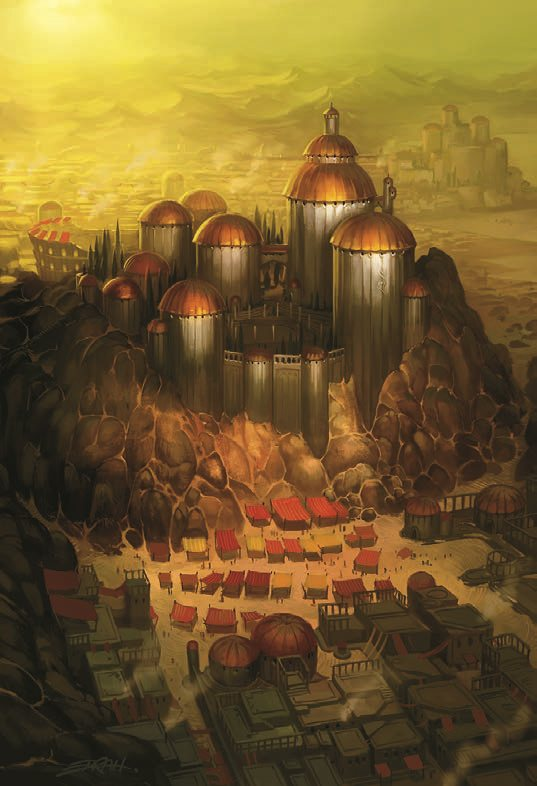

[Home](../Home.md) / [House Wavir](../House-Wavir.md) / Balic <!-- wikidown:breadcrumb -->

# Balic, the Two-Seas City

*The richest city on Aerun, and it did not get that way by fighting.*

Balic is built into the great rock dam at the foot of the **[Balic Saddle](The-Balic-Saddle.md)**, the one place the highland comes down low enough to cross. The ocean lies below it on one side; a sea of gray dust hangs above it on the other.

## At a glance

- **Population:** about 24,000. The wealthiest of the seven cities.
- **Ruling family:** House Wavir. Balic pays wages, and every other city loathes it for that.
- **Government:** genuinely peculiar. A **Chamber of Patricians** writes the laws, the **praetors** stand for ten-year elections, and the guilds vote. Cynics note who counts the votes. Optimists note that the votes are counted at all.
- **Trade:** everything, because everything must cross here: grain, salt, olives, wine, livestock, leather, and marble. The tolls are the real crop.
- **Water:** five public wells and the cisterns, rationed in dry years.

## What you will see

A city climbing in tiers up the face of the dam, precinct above precinct, linked by switchback ramps and tunnels. At the bottom is the **ocean harbor** with its breakwater lighthouses. At the summit are the **silt quays**, where schooners sit moored on the gray above the rooftops.

Cargo moves between the two on human backs. Endless files of porters work the **Stair of Sails** on the outside of the rock, and the **Cochlea**, the great spiral stair bored down through the dam, turns past market landings at every revolution, lit day and night. The up-file and the down-file never stop.

## Visitor's notes

- **Know your turn.** Ask which turn of the Cochlea someone lives off, and you will know their station. Balicans do it constantly and pretend they don't.
- **Go to the theater.** The theaters are the city's glory: dozens of them, from ramshackle stagehouses to noble amphitheaters. A good playwright is as famous here as a gladiator.
- **Mind the innkeeper.** Every free citizen serves three years in the legions, so the innkeeper who pours your wine has probably stood a wall against giants.

## Where to stay

- **The Olive Tree**, on the Road of Legions: a cheap, safe bed.
- **The Furled Sail**, on the docks: the other kind of evening.

## Outland guilds

Balic is where the world's guilds keep their doors on Aerun, because Balic is where guilds get a vote. You will find them in the **Guilders' Precinct**.

- **The Gleaners' chapter hall:** seed stores, soil maps, well surveys, and a standing offer to teach any grower on the Ring Road, free.
- **The G4CE office**, beside it, which **honors a G4CE medallion from anywhere in the world** and always has work.
- **The Academy of the Fettered Mind**, two streets over. Locals call it *the Fettered Mind*, since "the Academy" on Aerun means the Navigators'. It is **the only chartered school of arcane magic on the continent**: a colonnaded court, lecture halls, a library worth the climb, and guest rooms for visiting scholars. Balic licenses it because its creed is restraint, and it keeps every component under seal to prove it. Its masters wear their chains of mastery openly, a link for each discipline.

## Lately

Late this summer, after six tendays of the porters' work-to-rule slowdown, the factors hired the [Salt View](Salt-View.md) Principal Troupe to stage the **Fall of Yaramuke** at the foot of the Cochlea. All five Great Schools walked the turns during the play, and seven porters left the stair that night in School cloaks. The porters' gangs ended the slowdown the next morning on their own count, and the city posted a water increase and called it "seasonal." Balic is still arguing about what happened.

## Leaving Balic

- **East** on the Ring Road: [Altaruk](Altaruk.md) is 35 miles, then [Amber Valley](Amber-Valley.md), then Gulg at 140.
- **West** on the Ring Road: Urik, 150 miles, the southern run.
- **Across the silt:** the Guild's [Long Reach](../The-Caravan-Guild/The-Long-Reach.md) sails from the quays at the crest to Raam, five or six days away.
