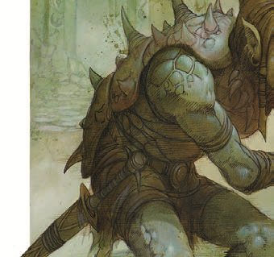

[Home](Home.md) / The Sea of Silt <!-- wikidown:breadcrumb -->

# The Sea of Silt and the Rim Wall

*"Beyond the Rim Wall, the world ends." (coastal proverb)*

<svg class="map focus-silt" viewBox="520 80 1120 1360" xmlns="http://www.w3.org/2000/svg" aria-label="Map of the Sea of Silt">
<defs><clipPath id="coast-clip"><path clip-rule="evenodd" d="M333,100 L500,75 L667,67 L800,50 L933,42 L1167,67 L1333,83 L1467,67 L1600,100 L1667,200 L1640,330 L1590,400 L1650,467 L1833,483 L1950,567 L2017,700 L2050,867 L2067,1033 L2083,1200 L2067,1333 L2033,1433 L1917,1467 L1750,1450 L1583,1467 L1417,1450 L1300,1467 L1167,1483 L1000,1467 L833,1483 L667,1450 L533,1467 L417,1450 L300,1367 L200,1300 L100,1200 L33,1067 L67,933 L83,767 L117,633 L100,533 L133,417 L183,300 L250,183 Z M717,158 L1450,167 L1433,333 L1383,550 L1450,700 L1500,800 L1467,933 L1317,1067 L1233,1167 L1217,1333 L1167,1333 L1100,1133 L1000,1000 L783,900 L700,783 L660,600 L650,400 L680,200 Z"/></clipPath><pattern id="silt-hatch" width="18" height="18" patternUnits="userSpaceOnUse" patternTransform="rotate(45)"><line x1="0" y1="0" x2="0" y2="18" class="hatch"/></pattern></defs>
<image href=".attachments/aerun-atlas.jpg" width="2176" height="1632"/>
<a href="The-Sea-of-Silt.md" class="region r-silt"><title>The Sea of Silt: no signal</title><path d="M717,158 L1450,167 L1433,333 L1383,550 L1450,700 L1500,800 L1467,933 L1317,1067 L1233,1167 L1217,1333 L1167,1333 L1100,1133 L1000,1000 L783,900 L700,783 L660,600 L650,400 L680,200 Z"/></a>
<g clip-path="url(#coast-clip)">
<a href="House-Vordon.md" class="region r-vordon"><title>House Vordon: Tyr and the Ringing Mountains</title><path d="M0,0 L650,0 L650,190 L720,190 L720,800 L450,800 L300,900 L0,1000 Z"/></a>
<a href="House-Tsalaxa.md" class="region r-tsalaxa"><title>House Tsalaxa: Draj and the north coast</title><path d="M650,0 L1250,0 L1250,200 L720,190 L650,190 Z"/></a>
<a href="House-Mke.md" class="region r-mke"><title>House M'ke: Raam and Blackguard</title><path d="M1250,0 L2176,0 L2176,400 L1700,430 L1440,430 L1430,200 L1250,200 Z"/></a>
<a href="House-Shom.md" class="region r-shom"><title>House Shom: Nibenay and the Badlands</title><path d="M1440,430 L1700,430 L2176,400 L2176,560 L1760,600 L1600,850 L1480,850 L1430,700 Z"/></a>
<a href="House-Inika.md" class="region r-inika"><title>House Inika: Gulg and the Crescent Forest</title><path d="M1760,600 L2176,560 L2176,1180 L1700,1180 L1550,1000 L1600,850 Z"/></a>
<a href="House-Wavir.md" class="region r-wavir"><title>House Wavir: Balic and the south</title><path d="M1480,850 L1600,850 L1550,1000 L1700,1180 L2176,1180 L2176,1632 L950,1632 L950,1250 L1150,1100 L1450,950 Z"/></a>
<a href="House-Stel.md" class="region r-stel"><title>House Stel: Urik and the Black Crown</title><path d="M0,1000 L300,900 L450,800 L720,800 L900,950 L1150,1100 L950,1250 L950,1632 L0,1632 Z"/></a>
</g>
<a href="The-Caravan-Guild/The-Ring-Road.md" class="guild"><title>The Ring Road (Caravan Guild)</title><path class="road" d="M930,110 L870,125 L775,100 L660,135 L620,160 L600,200 L590,240 L580,290 L540,330 L505,390 L515,455 L545,500 L545,560 L540,620 L525,690 L500,760 L470,800 L440,817 L480,972 L495,1112 L530,1167 L600,1252 L610,1282 L580,1310 L560,1340 L660,1342 L780,1372 L900,1402 L1000,1412 L1166,1405 L1276,1392 L1406,1382 L1506,1377 L1596,1372 L1686,1357 L1736,1322 L1796,1242 L1846,1132 L1851,1042 L1826,932 L1811,882 L1796,782 L1776,720 L1736,680 L1716,580 L1676,520 L1636,440 L1616,380 L1586,282 L1576,170 L1506,110 L1276,130 L1176,140 L1076,150 Z"/></a>
<a href="The-Caravan-Guild/The-Long-Reach.md" class="guild"><title>The Long Reach (Caravan Guild)</title><path class="reach" d="M1406,300 L1326,400 L1224,488 L1146,600 L1121,722 L1160,800 L1194,922 L1215,1050 L1220,1200 L1190,1330 L1166,1400"/></a>
<g class="here" aria-hidden="true"><circle cx="1150" cy="1430" r="24"/><circle class="pulse" cx="1150" cy="1430" r="24"/></g>
<g class="pins">
<a href="House-Wavir/Balic.md" class="pin city r-wavir"><title>Balic (you are here)</title><circle cx="1150" cy="1430" r="15"/></a>
<a href="House-Wavir/Altaruk.md" class="pin shared r-wavir"><title>Altaruk: held jointly, Wavir chief among them</title><circle cx="1420" cy="1370" r="11"/></a>
<a href="House-Wavir/Amber-Valley.md" class="pin shared r-wavir"><title>Amber Valley: neutral ground</title><circle cx="1705" cy="1395" r="11"/></a>
<a href="House-Wavir/Salt-View.md" class="pin r-wavir"><title>Salt View</title><circle cx="1640" cy="1260" r="11"/></a>
<a href="House-Wavir/The-Mekillot-Mountains.md" class="pin r-wavir"><title>The Mekillot Mountains</title><circle cx="1545" cy="1265" r="11"/></a>
<a href="House-Wavir/The-Balic-Saddle.md" class="pin r-wavir"><title>The Balic Saddle</title><circle cx="1250" cy="1240" r="11"/></a>
<a href="The-Caravan-Guild/The-Waystations.md" class="pin guildpin"><title>First Mark (Guild waystation)</title><circle cx="1224" cy="488" r="11"/></a>
<a href="The-Caravan-Guild/The-Waystations.md" class="pin guildpin"><title>Midreach (Guild waystation)</title><circle cx="1121" cy="722" r="11"/></a>
<a href="The-Caravan-Guild/The-Waystations.md" class="pin guildpin"><title>Saltbone (Guild waystation)</title><circle cx="1194" cy="922" r="11"/></a>
<a href="House-Stel.md" class="pin city r-stel"><title>Urik</title><circle cx="545" cy="1355" r="15"/></a>
<a href="House-Vordon.md" class="pin city r-vordon"><title>Tyr</title><circle cx="510" cy="450" r="15"/></a>
<a href="House-Tsalaxa.md" class="pin city r-tsalaxa"><title>Draj</title><circle cx="930" cy="95" r="15"/></a>
<a href="House-Mke.md" class="pin city r-mke"><title>Raam</title><circle cx="1586" cy="282" r="15"/></a>
<a href="House-Shom.md" class="pin city r-shom"><title>Nibenay</title><circle cx="1690" cy="495" r="15"/></a>
<a href="House-Inika.md" class="pin city r-inika"><title>Gulg</title><circle cx="1776" cy="720" r="15"/></a>
<a href="House-Inika.md" class="pin r-inika"><title>Ogo</title><circle cx="1898" cy="867" r="11"/></a>
<a href="House-Inika.md" class="pin r-inika"><title>The Crescent Forest</title><circle cx="1880" cy="690" r="11"/></a>
<a href="House-Shom.md" class="pin r-shom"><title>The Rust-Red Badlands</title><circle cx="1580" cy="600" r="11"/></a>
<a href="House-Mke.md" class="pin r-mke"><title>Blackguard</title><circle cx="1510" cy="115" r="11"/></a>
<a href="House-Vordon.md" class="pin r-vordon"><title>Eldorado</title><circle cx="470" cy="345" r="11"/></a>
<a href="House-Vordon.md" class="pin r-vordon"><title>Walis</title><circle cx="360" cy="95" r="11"/></a>
<a href="House-Vordon.md" class="pin shared r-vordon"><title>Osgaker</title><circle cx="175" cy="550" r="11"/></a>
<a href="House-Vordon.md" class="pin r-vordon"><title>The Ringing Mountains</title><circle cx="340" cy="640" r="11"/></a>
<a href="House-Vordon.md" class="pin r-vordon"><title>Bitter Well</title><circle cx="258" cy="868" r="11"/></a>
<a href="House-Stel.md" class="pin shared r-stel"><title>Hollowstorm</title><circle cx="85" cy="1090" r="11"/></a>
<a href="House-Stel.md" class="pin r-stel"><title>Mountain of the Black Crown</title><circle cx="405" cy="1130" r="11"/></a>
<a href="House-Stel.md" class="pin r-stel"><title>The Dragon's Bowl</title><circle cx="575" cy="850" r="11"/></a>
<a href="House-Stel.md" class="pin r-stel"><title>Lake Pit</title><circle cx="578" cy="928" r="11"/></a>
<a href="House-Stel.md" class="pin r-stel"><title>Yaramuke and the Black Oasis</title><circle cx="705" cy="1125" r="11"/></a>
</g>
<g class="labels" aria-hidden="true"><text x="585" y="600">VORDON</text><text x="1000" y="150">TSALAXA</text><text x="1470" y="240">M'KE</text><text x="1455" y="520">SHOM</text><text x="1960" y="1110">INIKA</text><text x="1880" y="1290">WAVIR</text><text x="770" y="1270">STEL</text></g>
</svg>

> **No signal.** The Aura network does not reach beyond the Rim Wall. There is no relay out there and never will be, so this chapter will never arrive. What follows is what can be seen and said from the coast.

## The Sea of Silt

The gray country fills the whole interior of Aerun, lying on top of the highland like water on a table. It is not sand. It is **dust finer than flour**, hundreds of miles of it, pale as ash and dead flat. Nobody owns it.

- **Where:** above you. The interior is higher than the coast. The silt's surface sits well over a thousand feet above the sea, held up by the Rim Wall, and from the lowlands you look *up* at it.
- **What it does:** it flows like water and it drowns like water. A person sinks. An animal sinks. There is no swimming in it and no bottom worth reaching.
- **Crossing it:** only three ways. The Guild's marked lane, [the Long Reach](The-Caravan-Guild/The-Long-Reach.md), aboard a silt skimmer; the shoals, ridges of firmer ground that shift with the seasons and are known to the desert tribes; or not at all.
- **Weather:** silt-storms, dust hurricanes that bury landmarks, rearrange the shoals, and can strip the paint off a hull. There is a season for them, and it is longer than anyone would like.

## The Rim Wall

The ring of cliffs that holds the interior up: a continuous wall of columnar ochre rock between the living coast and the gray country above. Wherever you stand on the Ring Road, it is the horizon.

- **The climb:** around two thousand feet from the lowlands to the crest in most places, sheer at the top over long fans of scree. On the inner side, the silt comes almost to the lip.
- **It is not uniform.** It is highest and most brutal in the north and west, where the Ringing Mountains merge with it. Along the eastern sweep it steps down into benches and ramps. At [the Balic Saddle](House-Wavir/The-Balic-Saddle.md) it comes down to a few hundred feet: the one place a road can cross.
- **Silt-falls:** where the rim dips, dust spills over the edge in slow, permanent cascades, smoking down the cliff face like gray waterfalls. Visible for miles, beautiful, and a sign the wind is up.

## Visitor's notes

- **Things live out there.** Something large moves beneath the surface where the silt is deep, and skimmer crews watch for its wake the way sailors watch for reefs.
- **Nothing goes northwest.** The northwestern reach carries no lane, no markers, and no charts. Pilots call it *the blank* and turn the conversation elsewhere. The Guild's rule is absolute.
- **Wear a veil.** Breathing the dust over days does permanent damage. Buy a good veil; the cheap ones are decoration.
- **Do not camp under a silt-fall** or a scree fan. Things fall off the wall. It is a beginner's mistake with an experienced person's consequences.
- **Only two ways over the wall matter for trade:** Balic's saddle in the south and Raam's shelf in the northeast. Everything else is a climb, and climbers do not come back with cargo.
